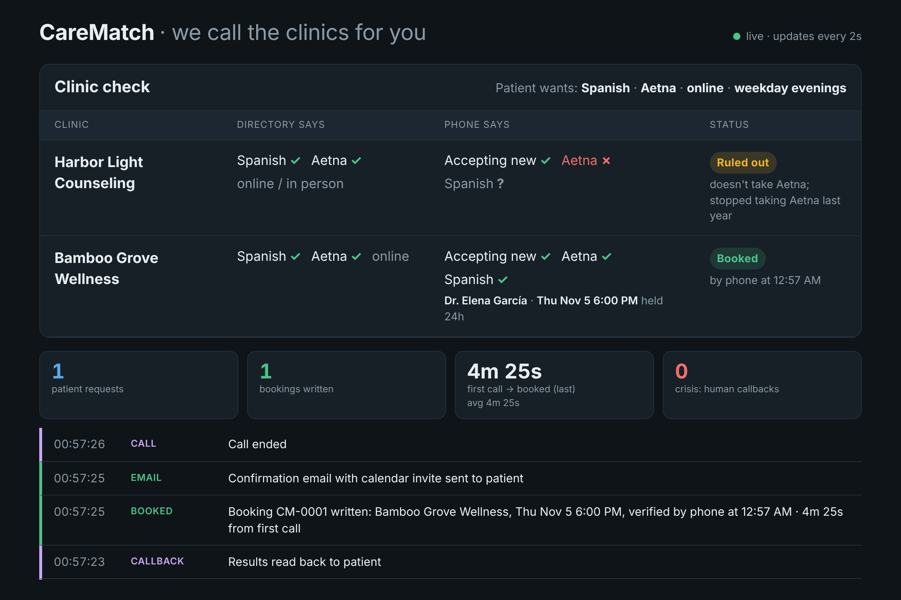

# CareMatch

**A voice agent that phones therapy clinics for you to verify insurance, language, and openings, then calls you back to book. Every fact comes from a real call.**

Built for the Bolna Buildathon (Symphony 2026) on Bolna voice agents.



*Dashboard from a scripted demo run of the backend (Spanish scenario). Clinics are fictional and timings are illustrative.*

## The problem

Finding a therapist who takes your insurance means calling down a list, and the list is usually wrong. In an October 2026 JAMA Health Forum study, researchers posing as patients made over 5,800 calls to mental health clinicians listed in insurer directories: fewer than a quarter ended in an appointment, and about 60% went unanswered. A 2023 US Senate Finance Committee secret-shopper study got appointments 18% of the time. Clinics have no API; the front-desk phone is the only source of truth.

Most voice AI in healthcare answers the phone *for the clinic*. **CareMatch makes the calls *for the patient*.**

## How it works

| | Agent (Bolna) | What it does | Backend |
|---|---|---|---|
| ① | **Intake** | Patient calls in and says what they need (language, insurance, online or in person, times). Reads back anything speech recognition may have misheard. Offers no times yet. | `/search_clinics` |
| ② | **Caller** | Phones each listed clinic. First sentence: it is an automated assistant. Asks four questions in under a minute: accepting new patients? take this insurance? a therapist who speaks this language? can you hold a slot for 24 hours? | `/report_clinic` |
| ③ | **Callback** | Calls the patient back with only what clinics confirmed by phone, and when. Books the held slot after the patient says yes. Sends a confirmation email with a calendar invite. | `/results`, `/book` |

The dashboard shows each clinic's directory listing next to what its front desk actually said, live during the calls.

Bolna agent configurations: see [`bolna_agents/`](bolna_agents/README.md).

## Safety design

1. The agent says it is an AI in its first sentence and never pretends to be human.
2. Clinic calls ask four questions, take under a minute, and never share the patient's name or health information.
3. A clinic that doesn't want automated calls goes on a do-not-call list that the backend enforces.
4. Clinics only hold a slot for 24 hours; the patient registers themselves.
5. Nothing is booked without the patient's explicit yes.
6. If the patient mentions self-harm, everything stops: the agent offers 911, 988 and a human callback. Crisis support never depends on any business relationship.
7. No transcripts are stored; the dashboard keeps one-line summaries only.

## Business model

Free for patients. Sold to universities and employers as a mental-health access benefit. Clinics join free. We never charge clinics per patient referred: per-referral fees are restricted in healthcare (anti-kickback and fee-splitting laws) and would bias which clinics get recommended.

## Next step

Call 20 real clinics with the AI disclosure and measure answer and completion rates. Longer term, clinics that join share their calendars directly, and phone calls cover the ones that haven't.

---

# Backend reference

This is the backend the three Bolna agents share. **All clinics, names and time slots in this demo are fictional.** State lives in memory and is cleared on restart.

## Flow

1. **Intake agent**: the patient calls in and states their needs → `POST /search_clinics`. The clinics listed in the directory appear on the dashboard as "To call". The agent offers no times and says CareMatch will call the clinics and call back.
2. **Caller agent**: CareMatch phones each clinic, says first that it is an AI, asks four questions (accepting new patients? take the insurance? a therapist who speaks the language? can you hold a slot for 24 hours?) → `POST /report_clinic`.
3. **Callback agent**: CareMatch calls the patient back → `POST /results` (what was confirmed by phone), then `POST /book` for the held slot. A confirmation email with a calendar invite goes out.

## Run (macOS)

```bash
cd carematch
source .venv/bin/activate
pip install -r requirements.txt -r requirements-dev.txt
pytest -q                                   # all tests should pass

export DEMO_TOKEN=pick-your-own-secret      # never commit this
# optional confirmation email (pick one):
export CONFIRM_EMAIL=patient@example.com
export RESEND_API_KEY=re_...                # Resend; or:
# export GMAIL_USER=you@gmail.com GMAIL_APP_PASSWORD=xxxx   # Gmail app password
uvicorn main:app --port 8000
```

Dashboard: http://localhost:8000/dashboard. Public URL for Bolna:

```bash
~/.local/bin/ngrok http --url=heritage-stood-tamer.ngrok-free.dev 8000
```

Email notes: with Resend's default sender (`onboarding@resend.dev`), mail only reaches the address that owns the Resend account, so sign up with the inbox you will demo with. Gmail needs 2-step verification and an app password (Google Account → Security → App passwords). Without any email settings, bookings still work and the dashboard says the email was skipped.

## Endpoints

| Endpoint | Used by | Auth |
|---|---|---|
| `POST /search_clinics` | Intake agent tool | `Authorization: Bearer $DEMO_TOKEN` |
| `POST /report_clinic` | Caller agent tool | `Authorization: Bearer $DEMO_TOKEN` |
| `POST /results` | Callback agent tool | `Authorization: Bearer $DEMO_TOKEN` |
| `POST /book` | Callback agent tool | `Authorization: Bearer $DEMO_TOKEN` |
| `POST /transfer_hook` | pre-transfer webhook (crisis) | `"secret"` field in the body |
| `POST /call_webhook?secret=$DEMO_TOKEN` | Bolna call webhook (all three agents) | secret in the URL |
| `POST /call_status?token=$DEMO_TOKEN` | same handler, older name | token in the URL |
| `GET /board` `/events` `/stats` | dashboard | none |
| `GET /dashboard` | your browser | none |
| `POST /reset` | you, before each demo take | `Authorization: Bearer $DEMO_TOKEN` |

Business outcomes, including refusals, return HTTP 200 with `{"ok": ..., "message": "..."}`; the agent follows `message`. Only a wrong token or secret returns 401.

### `/report_clinic` fields

All strings. Yes/no answers accept yes/no/true/false (any case); anything else counts as unknown.

| Field | Meaning |
|---|---|
| `clinic_id` | e.g. `C002` (pass it to the Caller agent as a call variable) |
| `accepting_new`, `takes_insurance`, `speaks_language`, `hold` | yes / no / unknown |
| `therapist` | name the front desk gave, e.g. `Dr. Chen` |
| `slot` | the held time. Best as `Thu Nov 5 6:00 PM` (so the calendar invite works); `Thursday 6pm` also works |
| `declined_ai` | yes if the clinic doesn't want automated calls → do-not-call list |
| `note` | short reason in the clinic's words, e.g. `stopped taking Aetna last year` |

Result: all four yes plus a slot → **Verified**. `declined_ai` yes → **Declined AI calls** (future reports refused). Otherwise → **Ruled out** with a reason.

### What else the backend handles

- **Misheard names**: "athena" → Aetna, "UHC" → UnitedHealthcare, "Aetna Better Health" → Aetna. When it corrects something, the search message tells the agent to read it back first.
- **Time to booking**: from the patient's first call to the booking, across all three calls.
- **Recordings**: when a clinic call ends, the webhook's `telephony_data.recording_url` is linked to that clinic and included in the confirmation email. The transcript is never stored.

## Bolna setup checklist

- All three agents: webhook URL `https://heritage-stood-tamer.ngrok-free.dev/call_webhook?secret=YOUR_DEMO_TOKEN`
- Intake: tool `search_clinics` (optionally `"call_id": "%(call_sid)s"`), plus the existing crisis transfer.
- Caller: tool `report_clinic`; opening line says it is an automated assistant and that the call is recorded so the patient can hear the answers. Never give the patient's name.
- Callback: tools `results` and `book`; ask for the name, read back clinic + time, wait for yes.
- Before each take: `curl -s -X POST $U/reset -H "$A"`.

## Test with curl (the demo story)

```bash
export DEMO_TOKEN=pick-your-own-secret
U=http://localhost:8000
A="Authorization: Bearer $DEMO_TOKEN"
J="Content-Type: application/json"

curl -s -X POST $U/reset -H "$A"

# 1. Patient calls in
curl -s -X POST $U/search_clinics -H "$A" -H "$J" \
  -d '{"language":"Mandarin","insurance":"Aetna","mode":"online","time_pref":"weekday evenings"}'

# 2a. Harbor Light: "We stopped taking Aetna last year"
curl -s -X POST $U/report_clinic -H "$A" -H "$J" -d '{"clinic_id":"C001","accepting_new":"yes",
  "takes_insurance":"no","speaks_language":"yes","therapist":"","slot":"","hold":"no",
  "declined_ai":"no","note":"stopped taking Aetna last year"}'

# 2b. Bamboo Grove confirms everything and holds Thursday 6 PM
curl -s -X POST $U/report_clinic -H "$A" -H "$J" -d '{"clinic_id":"C002","accepting_new":"yes",
  "takes_insurance":"yes","speaks_language":"yes","therapist":"Dr. Chen","slot":"Thu Nov 5 6:00 PM",
  "hold":"yes","declined_ai":"no","note":""}'

# (a clinic that refuses AI calls)
# curl -s -X POST $U/report_clinic -H "$A" -H "$J" -d '{"clinic_id":"C001","declined_ai":"yes"}'

# 3. Callback: what was confirmed, then book the held slot
curl -s -X POST $U/results -H "$A" -H "$J" -d '{}'
curl -s -X POST $U/book -H "$A" -H "$J" \
  -d '{"clinic_id":"C002","slot":"Thu Nov 5 6:00 PM","caller_name":"Sinclair","confirmed":"yes"}'

# Webhook a clinic call's recording (what Bolna sends when a call completes)
curl -s -X POST "$U/call_webhook?secret=$DEMO_TOKEN" -H "$J" \
  -d '{"status":"completed","telephony_data":{"recording_url":"https://example.com/rec.mp3"}}'

# Crisis: human callback requested
curl -s -X POST $U/transfer_hook -H "$J" \
  -d "{\"secret\":\"$DEMO_TOKEN\",\"transfer_reason\":\"Caller consented to human support\"}"

curl -s $U/board
curl -s $U/stats
```

## Fake clinics

Six clinics in `clinics.json`, all in New York. C001 Harbor Light and C002 Bamboo Grove are the two Mandarin + Aetna + online matches used in the demo. C006 (Korean, Oscar, in person) is deliberately hard to match. Names in `clinics.json` must match the canonical names in `normalize.py` (a test checks this).
